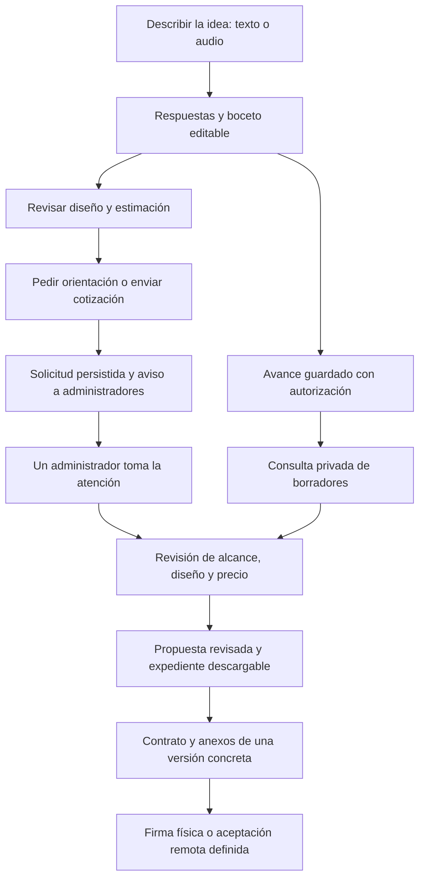

# Cotizador visual con NEXI: alcance y recorrido

Fecha: 25 de octubre de 2026.
Estado: primera definición completada para revisión. Describe comportamiento futuro; no activa IA, grabaciones, seguimiento, envíos ni firmas en producción.

## Objetivo

Permitir que una persona describa su proyecto escribiendo o hablando, vea un boceto que cambia con sus decisiones y solicite orientación o una cotización. El administrador recibe los avances autorizados, revisa la viabilidad y prepara una propuesta con alcance, diseño, precio y contrato vinculados a una misma versión.

La primera prioridad es la experiencia visual del cliente. El análisis del administrador forma parte del mismo recorrido. No se requiere entrenar un modelo propio para comenzar.

## Lo que ya existe y vamos a aprovechar

Comprobado en el código de D:\TUKNEX el 25 de octubre de 2026:

| Pieza | Situación actual | Evolución prevista |
| --- | --- | --- |
| Cuestionario | Objetivo, negocio, funciones, estilo, plazo y resumen | Mantenerlo como guía y añadir ayuda de NEXI y controles visuales |
| Vista previa | Componentes para web, catálogo y sistema; estilo y paleta derivados de respuestas | Configuración visual más rica, editable y con historial |
| NEXI | Reglas y conocimiento local; sin generación por proveedor externo | Interpretación, sugerencias y redacción con IA, conservando alternativa local |
| Borrador | Opcional, local y limitado a elecciones enumeradas; excluye texto libre/contacto | Guardado en servidor con información y autorización adecuadas |
| Solicitudes | Guardadas para clientes autenticados, con estimación y PDF | Conservar el envío formal y enlazarlo con una revisión del borrador |
| Precios | Catálogo y cálculo en backend | Desglose trazable sobre requisitos confirmados |
| Administración | Respuestas, seguimiento, documentos y gestión de contratos | Borradores, asignación de atención, revisión de diseño y expediente |
| Correo | Integración para verificación/recuperación | Servicio de avisos de solicitudes separado de la verificación de cuenta |
| Contratos | PDF y estados administrativos de firmas externas | Anexo visual versionado y mecanismo de aceptación por decidir |

No se considera completada ninguna de las nuevas capacidades por el hecho de que exista una pieza parecida.

## Recorrido acordado

Ver un borrador no autoriza contactar a la persona ni significa que haya enviado una solicitud. Tampoco inicia un contrato.

## Experiencia del cliente

### 1. Entrada y guía

- Se reutilizan los seis pasos actuales y la opción de consultar una estimación sin registrarse.
- Escritorio: preguntas y ayuda a la izquierda, lienzo a la derecha.
- Celular: acceso claro para alternar entre responder y visualizar; se conserva el punto del cuestionario.
- El cliente puede escribir y, cuando se incorpore voz, dictar respuestas. Los controles de micrófono deben ser explícitos; no se empieza a grabar automáticamente.
- Se informa cuándo un contenido es una sugerencia de NEXI o material de ejemplo.

### 2. Lienzo que cambia con las decisiones

Controles iniciales previstos: paleta y colores principal/secundario/fondo, familias tipográficas de un catálogo permitido, escala de texto, espaciado, estilo de botones/tarjetas, distribución de portada y orden/visibilidad de secciones.

No es un editor libre de píxeles en la primera entrega. El prototipo inicial se centra en una web/catálogo de restaurante ficticio para comprobar el recorrido completo, sin eliminar las categorías actuales de tienda, sistema o rediseño. La riqueza de esas categorías se amplía en entregas posteriores.

Los cambios visuales explícitos se aplican de inmediato mediante componentes. Las peticiones en lenguaje natural pasan por interpretación y validación; las sugerencias de funciones requieren aceptación. Debe haber deshacer, restaurar y un resumen de lo que cambió. NEXI no modifica silenciosamente una elección fijada por el cliente.

Ejemplo: «Quiero fotos grandes y que me pidan por WhatsApp» modifica la composición y propone catálogo/contacto. No incorpora pagos con tarjeta sin preguntar.

### 3. Uso de IA

- Interpreta descripciones, redacta alternativas y propone cambios estructurados; el navegador no ejecuta HTML o JavaScript arbitrario generado por el modelo.
- Cada propuesta indica qué respuestas la sustentan y qué información falta.
- Se distingue entre expresado por el cliente, sugerido por NEXI, aceptado por el cliente y pendiente de confirmar.
- Las respuestas libres del cliente son datos del proyecto; no pueden cambiar permisos, tarifas, políticas o instrucciones del servidor.
- Las llamadas se agrupan tras una pausa, una respuesta terminada o una acción explícita. No se consulta al proveedor por cada tecla.
- Si el cliente escribe mientras llega una respuesta, no se aplica una interpretación de una revisión anterior. Debe descartarse o solicitar una nueva revisión.
- Un fallo de IA conserva las respuestas, permite seguir con el cuestionario y muestra una alternativa comprensible. No se simula que respondió un modelo cuando se usaron reglas locales.

### 4. Audio

Primera modalidad prevista: pulsar para grabar una respuesta breve, detener/cancelar, transcribir y revisar. La duración y cuota se concretan antes de conectar un proveedor.

La transcripción literal y la redacción sugerida son campos distintos. El cliente confirma el texto ordenado antes de incorporarlo. Si hay dudas sobre nombres, cantidades, fechas o funciones, se pregunta. No se equipara un audio de ideación con aceptación contractual.

La conversación continua con transcripción en directo queda después de validar esta modalidad. La conservación del audio original tiene finalidad, plazo y permisos propios; no se guarda indefinidamente por defecto.

### 5. Opinión y acciones finales

El cliente puede indicar «Me gusta», «Quiero cambios» o «Necesito orientación» y añadir un comentario. Esto no equivale a aceptar un contrato.

«Pedir orientación» crea una solicitud de atención con el avance disponible; se puede hacer sin terminar todas las preguntas y requiere un medio de contacto para obtener respuesta. «Enviar cotización» conserva el proceso autenticado actual en la primera integración y congela las respuestas y el boceto enviados. No se presupone un nuevo envío formal anónimo.

Ambas acciones muestran confirmación solo después de persistir. Los fallos de correo no borran ni duplican la solicitud.

## Guardado y visibilidad de avances

El administrador puede consultar avances antes del envío formal, siempre bajo el tratamiento informado y autorizado que se defina. No se publica un seguimiento oculto.

| Visitante | Información disponible al administrador |
| --- | --- |
| Sin cuenta y sin datos identificativos facilitados | Identificador de borrador, avance autorizado y última versión del boceto |
| Con cuenta | Borrador propio enlazado a la cuenta y datos de contacto permitidos |
| Pide orientación | Solicitud de atención, contacto facilitado y revisión del borrador utilizada |
| Envía cotización | Solicitud formal y copia inmutable de sus respuestas, boceto y estimación |

Un identificador de sesión no garantiza anonimato si el texto contiene datos personales. No se deduce la identidad a partir de IP ni se utiliza huella de dispositivo.

Se propone guardar por respuesta terminada o pausa y al cambiar de paso, con revisiones y control de concurrencia. Debe mostrarse el estado de guardado y conservarse una alternativa local si la red falla. La vinculación de un borrador a una cuenta se comprueba en el servidor; no se acepta un userId o draftId como prueba de propiedad.

Antes de activar el guardado remoto se definirán aviso, base jurídica/consentimiento cuando corresponda, finalidad, acceso, eliminación y plazo de conservación. Los borradores sin autorización para el servidor siguen siendo locales. El plazo de retención no queda aprobado por este documento.

## Descripción común y versiones

Se añadirá una descripción estructurada del proyecto como nexo entre formulario, IA, vista previa, precio y documentos. Su esquema se validará en el servidor y no sustituirá sin migración el formulario vigente.

| Grupo | Contenido |
| --- | --- |
| Identidad técnica | Versión del esquema, identificador, revisión y fechas |
| Respuestas originales | Pregunta, valor y origen: escrito, transcrito o elección |
| Necesidades | Objetivos, requisitos, evidencia y situación de confirmación |
| Diseño | Pantallas/secciones, contenido, paleta, tipografías, escalas y recursos |
| Propuestas de NEXI | Cambios sugeridos, motivo, dudas y aceptación/rechazo |
| Estimación | Revisión y reglas utilizadas, partidas, supuestos y evaluación pendiente |
| Seguimiento | Progreso, valoración del boceto, solicitud de atención y asignación |
| Revisión administrativa | Alcance ajustado, restricciones, precio final y diferencias respecto al cliente |
| Documentos | Revisiones exportadas, anexos, propuesta y contrato asociados |

Se conservan por separado: borrador del cliente, copia enviada, propuesta del administrador y versión contractual. Las ediciones del administrador parten de una copia y conservan el original. Un contrato aceptado y sus anexos no pueden cambiar; una modificación crea otra versión y exige el proceso de aceptación correspondiente.

No se unifican todos los estados en un solo campo: progreso del borrador, valoración visual, atención comercial, cotización y contrato son procesos diferentes. Los estados actuales de solicitudes y contratos deben seguir funcionando durante la incorporación gradual.

## Estimación de precio

- El modelo propone requisitos; el cálculo se ejecuta en backend con el catálogo y las reglas comerciales del administrador.
- El presupuesto del cliente ayuda a priorizar y no determina arbitrariamente el precio.
- Mostrar un rango, partidas/supuestos y revisión de reglas. Una partida sin tarifa o alcance suficiente exige evaluación; no se inventa un importe.
- Se calcula con requisitos confirmados, no con sugerencias descartadas ni con datos del navegador no validados.
- El diseño y la estimación se vinculan a la misma revisión. Si cambia una función, el importe anterior queda desactualizado hasta recalcular.
- El administrador establece y aprueba la oferta final. Precio preliminar, preferencia de pago y calendario contractual son datos diferentes.

## Administración y atención

El panel distinguirá borradores, solicitudes de orientación, cotizaciones enviadas y propuestas revisadas. Permitirá consultar el último avance autorizado y reproducir el boceto de una revisión, identificar dudas y comparar la idea original con la propuesta administrativa.

Una sola persona toma la atención con una operación atómica. Si dos administradores intentan asignarse la misma solicitud, solo uno obtiene la asignación. Reasignaciones y cambios quedan registrados; leer el borrador no lo asigna ni cambia su estado.

El informe asistido tendrá: resumen, alcance, entregables, prioridades, exclusiones, preguntas, dependencias, dirección visual y criterios de aceptación. Se puede editar, pero no sustituye la revisión profesional de viabilidad, presupuesto y condiciones.

## Avisos por correo a administradores

Eventos que generan avisos: petición explícita de orientación y envío formal de cotización. Las pulsaciones, autosaves, visitas y valoraciones visuales no envían correos por sí solos. «Necesito orientación» dispara la petición solo al confirmar esa acción y los datos mínimos.

Destinatarios: cuentas de administrador activas y con correo válido/configurado para recibir avisos; comprobar destinatarios también al procesar reintentos. Se envía por destinatario para no exponer entre sí sus direcciones.

Contenido mínimo: número y tipo de solicitud, nombre facilitado o visitante, resumen breve, fecha y enlace al panel con inicio de sesión. No adjuntar DNI, grabaciones ni documentos privados ni usar enlaces públicos que otorguen acceso al proyecto.

La solicitud y el evento pendiente se guardan juntos en una bandeja de salida persistente. Una clave por evento/destinatario impide duplicados por reintentos. Se registran intentos, respuesta del proveedor y fallos para gestión, sin prometer que la aceptación del proveedor garantice entrega en bandeja de entrada. Las peticiones de orientación repetidas mientras una atención siga abierta se agrupan para evitar spam.

Antes de activar se comprobará la entrega real a todos los administradores con un remitente autorizado. El servicio de avisos no dependerá de activar la verificación de registro ni de VERIFICATION_SECRET. Habrá que resolver dónde se ejecutan los reintentos cuando no hay tráfico; no basta con un temporizador en memoria ni se garantiza atención instantánea.

## Exportación y contratos

El expediente incluirá resumen, respuestas autorizadas, alcance revisado, pendientes, cotización, capturas del prototipo, paleta con códigos, tipografías y referencias a recursos. Solo se incluirán recursos propios, autorizados o identificados como referencia; no se promete que toda imagen externa sea reutilizable.

Se renderiza una revisión concreta con dimensiones conocidas para obtener imágenes reproducibles. El mecanismo de generación y almacenamiento privado se decide y valida antes de prometer formatos o costes de operación. No depende de las herramientas del asistente de desarrollo.

El contrato tendrá un anexo visual/técnico que corresponda al mismo alcance e importe. La plantilla comercial y el método de aceptación requieren revisión legal para Perú antes de activarse. Vías previstas: PDF para firma física; aceptación electrónica remota con trazabilidad definida; integración de firma digital con certificado si se elige.

Fotos del DNI, firma dibujada o audio no se presentan como firma digital con certificado. No se recogen copias del DNI ni se habilita una aceptación vinculante en esta primera etapa. El consentimiento de grabación, el guardado del borrador y la aceptación contractual son acciones separadas.

## Decisiones de trabajo para comenzar sin bloquearse

1. Primer caso de diseño: restaurante ficticio con catálogo y contacto por WhatsApp, sin cobros reales.
2. Primer prototipo escrito, local y por componentes, para revisar controles, sugerencias y deshacer. No se presenta como IA conectada.
3. Mantener el cuestionario actual y sus categorías; mejorar por entregas sin reemplazo total.
4. Añadir después IA real mediante el backend y respuesta estructurada. No se ejecuta un modelo grande dentro del servicio web como supuesto inicial.
5. Audio por respuesta antes de conversación continua.
6. No activar guardado remoto, correos, claves de IA, proveedores pagados ni firmas hasta contar con sus decisiones y configuración necesarias.

## Decisiones abiertas y momento en que hacen falta

| Decisión | Necesaria antes de |
| --- | --- |
| Presupuesto mensual de IA/audio y límites por visitante | Elegir y activar proveedor/modelo |
| Aviso, autorización aplicable y retención de avances/audio | Guardado remoto y grabaciones |
| Familias tipográficas y controles visuales finales | Cerrar el prototipo visual |
| Tarifas, partidas sin precio y reglas de revisión | Publicar nuevas estimaciones |
| Remitente autorizado, destinatarios y ejecución de reintentos | Envío real de avisos |
| Modalidad de aceptación y plantilla revisada | Contratación remota |

Estas decisiones no impiden completar la definición ni crear el primer prototipo local.

## Comprobación de esta primera etapa

- [x] Revisar las piezas existentes y sus límites.
- [x] Definir recorrido de cliente, visitante y administrador.
- [x] Separar borrador, envío formal, propuesta y contrato.
- [x] Definir controles visuales, cambios sugeridos y confirmaciones.
- [x] Separar transcripción e interpretación.
- [x] Definir guardado, propiedad, versiones y privacidad pendiente.
- [x] Definir cálculo de precio y relación con el alcance.
- [x] Incorporar avisos, asignación y gestión de fallos.
- [x] Especificar expediente y anexo contractual.
- [x] Preparar caso de ejemplo y pendientes verificables.

La revisión del usuario sigue pendiente. La finalización de esta definición no equivale a aprobación de nuevas tarifas, tratamiento de datos, proveedor o método de firma.

## Referencias

- Código: frontend/src/components/quote-stepper-form.tsx; frontend/src/lib/quote/preview.ts; frontend/src/components/quote/solution-preview.tsx; frontend/src/lib/assistant/guided-provider.ts.
- Backend: backend/src/quotes/quote-requests.ts; backend/src/domain/pricing.ts; backend/src/auth/delivery.ts; backend/src/documents/pdf.service.ts.
- [Transcripción: documentación oficial de OpenAI](https://developers.openai.com/api/docs/guides/transcription).
- [Respuestas estructuradas: documentación oficial de OpenAI](https://developers.openai.com/api/docs/guides/structured-outputs).
- [Reglamento de protección de datos personales de Perú](https://www3.congreso.gob.pe/Docs/DGP/DIDP/files/ds_016-2024-jus.pdf).
- [Ley 27269](https://www.pj.gob.pe/wps/wcm/connect/668e158041f142deb24af609e23c56e1/Ley27269.pdf?MOD=AJPERES).
- [DS 082-2024-PCM: marco de firma digital](https://busquedas.elperuano.pe/api/visor_html/2312893-1).
